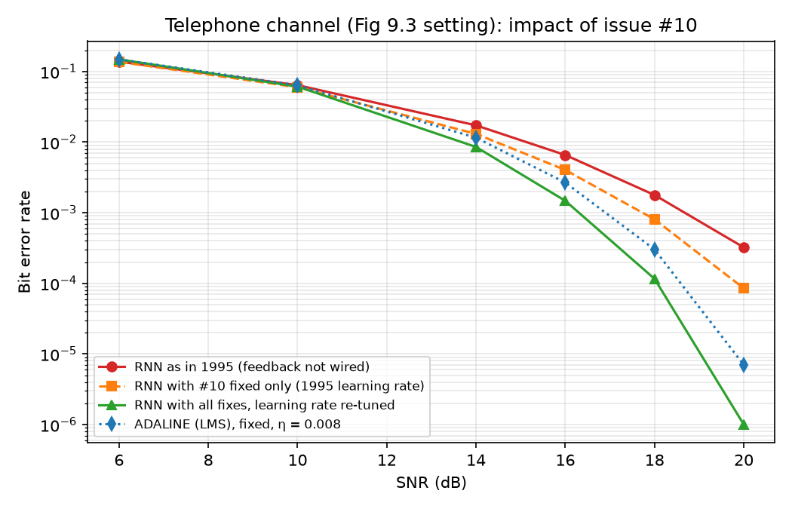
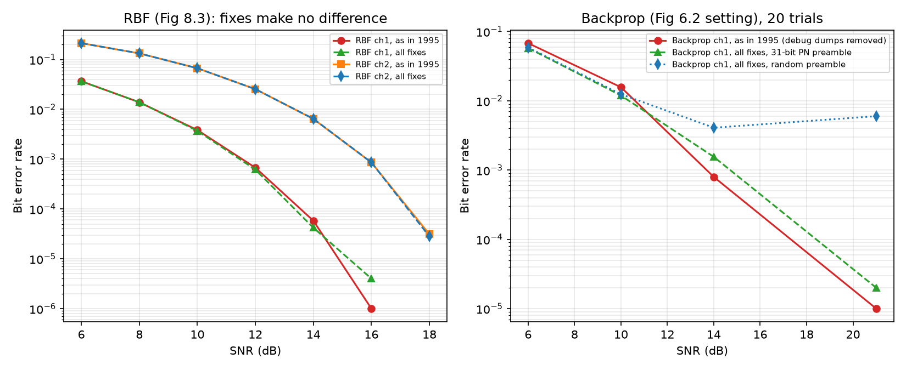

# anneq

Adaptive channel equalisation with neural networks: a 1995 BEng final-year project, recovered from its paper report and rebuilt 30 years later.

The project compared an [LMS](#glossary)/[ADALINE](#glossary) [equaliser](#glossary) with three neural equalisers: a backprop multilayer perceptron, a recurrent network trained by [RTRL](#glossary), and an [RBF](#glossary) network. It used simulated data channels, including a telephone line. Its conclusion was qualified, not a rejection: networks of a practical size, trainable on 1995 hardware within a modem's preamble, gave no worthwhile gain over LMS, and the hardware to run them didn't yet exist.

This revisit, done in 2026, had two purposes:

- to exercise the current [AI](#glossary) toolset on a real project, given 30 years of progress: both the Python machine-learning libraries and AI-assisted coding;
- to find the bug the author had always suspected was there. It was found: the recurrent network's feedback was never connected ([#10](https://github.com/teknoplop/anneq/issues/10)).

### How long it took

| | 1994–95 | 2026 |
|---|---|---|
| Wall-clock time | About 10 months, alongside final-year lectures | 3 days (30 October – 1 November) |
| Hands-on time | Most of 8 months | About 6½ hours of interactive sessions |
| Compute | Overnight runs on 16–20 lab PCs (486s), 17:00 to 07:00 | About 5 hours of AI agents working in parallel in the background, and minutes of simulation on an Apple M4 Mac mini |

In 2026 the recovery, rebuilding, debugging, simulation and rewriting (including this README and the new versions of the report) were done by Claude Code (Anthropic's Claude Opus 5.5 model) working under the author's direction. The author's time went mostly on curating the repository: reviewing results and wording, correcting the verdicts, and keeping personal details out of the history. The timings come from the session logs. They cover time spent working in the sessions, not the physical scanning or floppy reading.

This repo holds the recovered report, the 1995 code, rebuilds of it on [DOS](#glossary), macOS and Python, a list of the bugs the rebuilds found, a 2026 redo of the study, and an [FPGA](#glossary) experiment.

## Findings

- **The rebuilds reproduce the report.** The original C, built natively, in Python and as 16-bit DOS executables under DOSBox-X, gives the same results across all builds and matches the report's figures (for example Fig 5.5: 3.42e-3 against ~3.5e-3 at 10 dB). See [results/RESULTS.md](results/RESULTS.md).
- **The code had bugs that biased the comparison against the networks.** The recurrent network's feedback was never connected, the training preamble repeated a 31-bit sequence, and there are others. With all fixes, the recurrent network beats the ADALINE on the telephone channel above 10 dB, but at about 30× the training computation, so the report's "practically sized network" conclusion stands. See issues #10–#19, [results/RESULTS_FIXED.md](results/RESULTS_FIXED.md) and the corrected edition `docs/report_1995_corrected.docx`.
- **The code is the author's own.** A comparison with the code disk from Welstead's *Neural Network and Fuzzy Logic Applications in C/C++* (1994) found no shared code. See [results/WELSTEAD.md](results/WELSTEAD.md).
- **Under the 1995 constraints, the 2026 answer is the same.** The project studied *adaptive* equalisers, which learn each call's line from its bounded preamble within a modem's budget; on that problem [RLS](#glossary) and the [DFE](#glossary) still win. Trained in advance, a different design that needs training resources 1995 didn't have, networks beat linear equalisers on short and non-linear channels, but the DFE still wins on the telephone line. See [docs/report_2026.md](docs/report_2026.md).
- **A stricter language would have caught 3 of the 9 code bugs outright** and made 2 more hard to write, including the suspected #10; the rest are algorithm or design errors. See [results/LANGUAGE.md](results/LANGUAGE.md).
- **A small FPGA trains the network about 500× faster than a 486**, but slower than one core of a modern [CPU](#glossary). See [gateware/RESULTS.md](gateware/RESULTS.md).

## The bug fixes in pictures

The recurrent network's feedback was never connected ([#10](https://github.com/teknoplop/anneq/issues/10)). Fixing it and re-tuning the learning rate takes the RNN past the ADALINE on the telephone channel above 10 dB. The RTRL fix (#11) turned out only to rescale the learning rate ([isolation run](results/RNN_ISOLATION.md)):



The other two networks had no bug in their training, so the fixes barely move them. The RBF curves are unchanged; the backprop differences are trial-to-trial spread over only 20 trials (one trial stuck in a poor minimum lifts the random-preamble curve above 14 dB):



## Layout

Naming in `src/`: `borland/` is the 1995 code; `anneq_*` and `clang/anneq/` are 2026 ports of it; files with no prefix are new 2026 code.

| Path | Contents |
|---|---|
| `docs/` | The scanned report (`report_scan.pdf`, names covered), [OCR](#glossary) text of the 82-page report in reading order (`report_text.md`), a concise rewrite with summaries (`report_rewrite.md`), the Word rebuilds of the report (`report_1995/`, `report_1995*.docx`) and the 2026 study's report (`report_2026.md`) |
| `src/borland/` | The 14 source files from the report's listing, verbatim (LMS, [RNN](#glossary), [BPBC](#glossary) backprop, [RB](#glossary)) |
| `src/openwatcom/` | Open Watcom build of the 1995 code for DOSBox-X, and the Borland compatibility shims the clang builds share |
| `src/clang/` | Native clang builds of all four programs, original and with fixes; sanitiser runs |
| `src/clang/anneq/` | C++23 port of all four programs, readable side by side with `src/borland/` (std::print, vectors, ranges, named bias/feedback inputs instead of +1 offsets); all fixes by default, `EQ_FIX` / `EQ_NOFIX` as the Python; byte-exact with the C builds and `anneq_fixed.py` (`src/tools/check_cpp.py`) |
| `src/anneq_orig.py` | Line-for-line Python port of all four programs (`anneq_orig.py LMS TEST`); matches the C bit for bit |
| `src/anneq_fixed.py` | The four programs with the bugs of issues #10–#18 fixed (all by default; `EQ_FIX` / `EQ_NOFIX` select) |
| `src/anneq_numpy.py` | Fast vectorised ADALINE/LMS (not bit-exact); one Fig 5.4 curve comes from it |
| `src/anneq.py` | The four simulators as idiomatic Python 3.15 (numpy/scipy, dataclasses, one CLI: `uv run src/anneq.py {lms,rnn,rbf,bp} --channel ch1 --snr 10`): the 1995 algorithms with the bugs fixed, checked statistically against `anneq_fixed.py` (`results/pythonic/compare.md`, tests in `src/tests/`) |
| `src/*.py`, no prefix | New 2026 code: the study redone as a 2026 undergraduate would (`channels`, `data`, `linear`, `neural`, `trellis`, `metrics`, `experiments`): PyTorch, RLS/DFE/Viterbi baselines. Tests in `src/tests/` |
| `src/fixes/` | One patch per C bug fix (#10–#13, #17), each with its explanation and issue link; the clang build applies them with `patch` |
| `src/tools/` | Extract the listing, prepare it for modern compilers, apply bug fixes, check the Python ports against the C |
| `scenarios/` | Scripts that run the report's scenarios on every build, compare and plot them; the 2026 study's run/plot scripts and config |
| `results/` | All outputs and write-ups: `rebuild/`, `fixed/`, `pythonic/`, `dos/`, `y2026/`, `fpga/`, and `RESULTS.md`, `RESULTS_FIXED.md`, `WELSTEAD.md` |
| `gateware/` | Fixed-point backprop engine for an Icepi Zero ([ECP5](#glossary)-25F) board; Verilog, C reference model, notes (`RESULTS.md`) |
| `vendor/` | Icepi Zero board files (submodule) |

[PROGRESS.md](PROGRESS.md) logs how each part was built and run.

## Quick start

### Rebuilt 1995 programs and scenarios

The programs read their settings from `*_CON.TXT` files next to the executable and write results such as `ERRORS.TXT`, `BER.TXT` and `FAIL.TXT`; `scenarios/run_scenarios.py` writes these for each job.

```bash
make -C src/clang all fixed
uv run --no-project --with numpy --with matplotlib python scenarios/run_scenarios.py
make -C src/clang variants && uv run --no-project python src/tools/check_pyport.py   # Python ports vs C, byte for byte
make -C src/clang/anneq && uv run --no-project python src/tools/check_cpp.py      # C++ port vs C and Python, byte for byte
```

The Python ports run the same way, in a folder holding the config files: `python src/anneq_orig.py LMS TEST` (or `RNN`, `RB`, `BPBC`), and `src/anneq_fixed.py` for the corrected programs (`scenarios/run_fixed.py` reruns the scenarios with it).

`scenarios/run_dos.py` runs the DOS builds under DOSBox-X; build them first with `src/openwatcom/build.sh`, which needs Open Watcom.

### 2026 study

```bash
uv run --extra test pytest -q
uv run scenarios/run_y2026.py all --jobs 8
uv run scenarios/plot_y2026.py
```

### FPGA

`gateware/run_mini.sh` rebuilds the bitstream with Yosys and nextpnr, checks it against the C model in Verilator, and reruns the board measurements.

## Not included

The Welstead disk's contents aren't included: its licence allows use on a single computer only.

## Glossary

| Term | Meaning |
|---|---|
| ADALINE | Adaptive linear neuron: a single linear neuron trained by LMS (Widrow and Hoff, 1960) |
| AI | Artificial intelligence |
| BPBC | The 1995 backpropagation simulator (`BPBC.C`), a multilayer perceptron trained by backpropagation |
| CPU | Central processing unit |
| DFE | Decision-feedback equaliser: a linear equaliser plus feedback of past decisions |
| DOS | MS-DOS, the PC operating system the 1995 programs ran on |
| ECP5 | Lattice ECP5, the FPGA family on the Icepi Zero board |
| Equaliser | A filter in a receiver that undoes the channel's smearing of each symbol into its neighbours (intersymbol interference), so the bits can be read correctly |
| FPGA | Field-programmable gate array |
| LMS | Least mean squares: the stochastic-gradient rule that adapts an ADALINE's weights |
| OCR | Optical character recognition |
| RB | The 1995 RBF simulator (`RB.C`) |
| RBF | Radial basis function (network) |
| RLS | Recursive least squares: a faster-converging, costlier alternative to LMS |
| RNN | Recurrent neural network: a network whose outputs feed back into its inputs |
| RTRL | Real-time recurrent learning: the training rule used for the 1995 RNN |
