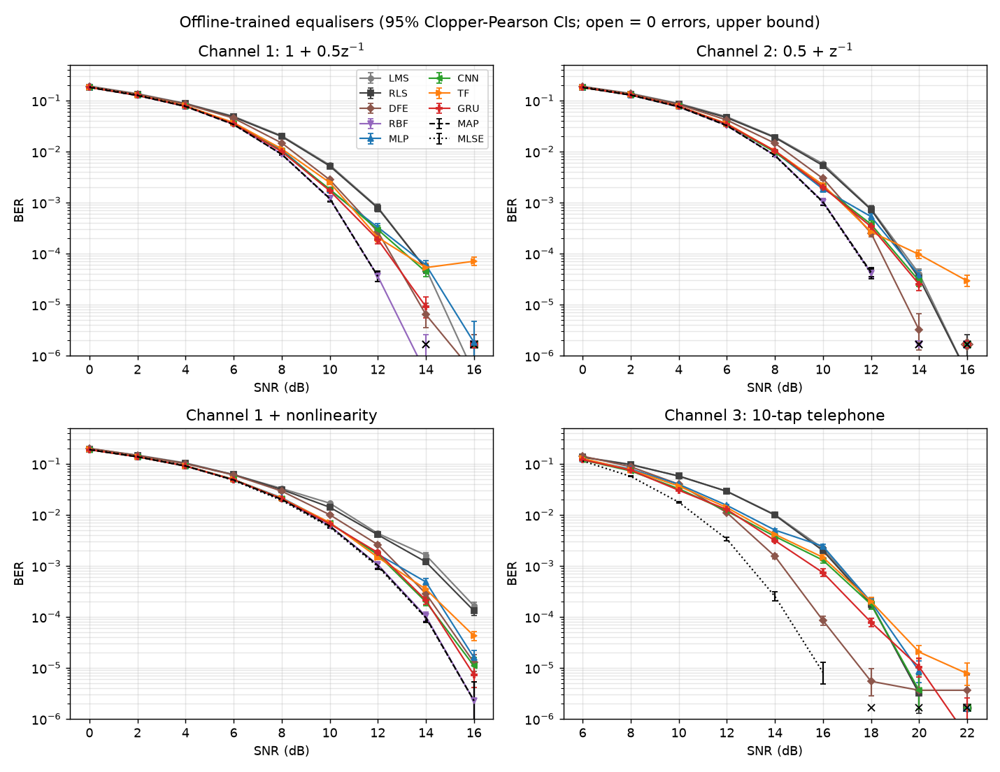
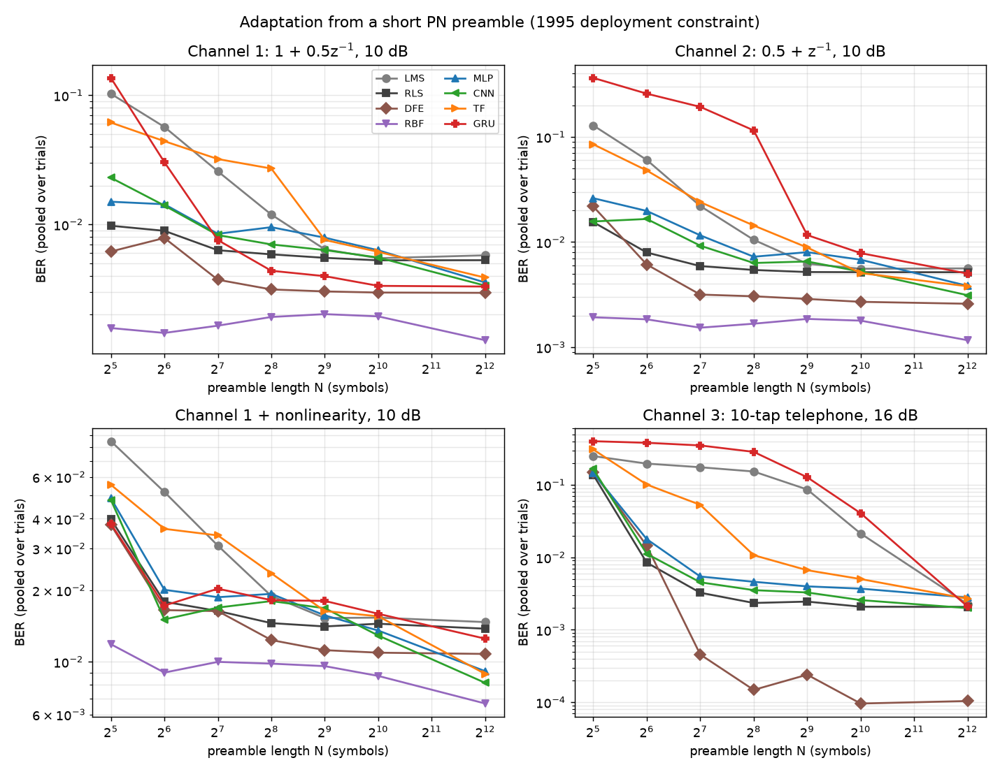

# Neural-network channel equalisation, revisited (2026)

A re-run of a 1995 BEng final-year project ([report_rewrite.md](report_rewrite.md)), done the way a strong
2026 undergraduate would do it. Tracking issue: teknoplop/anneq#20. To regenerate everything:

```
uv run --extra test pytest -q                 # 19 tests (src/tests/)
uv run scenarios/run_y2026.py all --jobs 8    # ~20 min on an M1 (8 cores); 8.3 min on an M4 (10 cores) via Y2026_HOST=<ssh host>
uv run scenarios/plot_y2026.py                # results/y2026/figures/*.png, results/y2026/tables.md
```

## TL;DR for an accountant

The revisit had two purposes: to exercise today's AI tools on a real project, 30 years on (both the Python machine-learning libraries and AI-assisted coding), and to find the bug the author had always suspected was there. This study is the second half of that: the same question, answered with 2026 methods.

In 1995 this project asked whether "neural networks" could clean up the errors a telephone line puts into data, better than the standard method that modems already used. The answer then was no: the networks were no more accurate, and they needed far more computing power than a modem could afford. Redoing the work in 2026 with modern tools gives the same answer under the same conditions: when the equaliser must learn quickly from a short test signal on cheap hardware, the standard methods still win. Training a network in advance, on a computer far bigger than a 1995 lab, does let it beat the standard methods on simple and on distorted lines, though still not on the realistic telephone line. But that is a different design from the one the project set out to test. An *adaptive* equaliser learns each call's line from that call's short test signal, within a modem's budget, and training a network in advance across many lines needed computing resources that nobody had in 1995. The whole 2026 study took about 8 minutes on a small desktop computer; the same training would have taken roughly ten nights of the entire 1995 university lab.

## 1. Aims

1. Compare classical and neural equalisers **fairly**: the same input window, the same decision
   delay and the same data for every method, with the optimum detectors as references.
2. Separate the two ways an equaliser can be deployed: **adaptation from a short preamble** (the
   1995 modem constraint) and **offline training** on plenty of data (the 2026 model).
3. Add a mildly **non-linear** channel, which a linear equaliser cannot match by design.
4. Report what each method costs: parameters, multiply-accumulates (MACs) per symbol, training
   data and training time.

## 2. Method

**Signal model.** BPSK symbols ±1 pass through an FIR channel h, an optional memoryless
nonlinearity f, and AWGN. SNR = E[f(h∗s)²]/σ², with the signal power computed exactly over every
channel state.

| channel | model | window m | delay d |
|---|---|---|---|
| ch1 | 1 + 0.5z⁻¹ | 7 | 2 |
| ch2 | 0.5 + z⁻¹ (non-minimum phase) | 7 | 5 |
| ch1nl | ch1, then y = x + 0.2x² − 0.1x³ | 7 | 1 |
| ch3 | 10-tap telephone line (0.047 … 0.011) | 15 | 8 |

Every method on a channel uses the same m and d. The delay d is the one that minimises the
linear equaliser's MSE at 12 dB (`channels.mmse_delay`), so if the choice favours anyone it
favours LMS and RLS.

**Methods** (unprefixed modules in `src/`):

| family | method | notes |
|---|---|---|
| linear | LMS (normalised); RLS (λ=0.999); DFE (RLS-trained, L−1 feedback taps, decision-directed at test) | all have a bias input |
| optimum, known channel | MLSE (Viterbi over the whole sequence) | absolute bound |
| | MAP symbol-by-symbol decision on the m-sample window with delay d (Bayesian) | the best any window equaliser can do; ch1/ch2/ch1nl only, since it needs 2^(m+L−1) centres |
| learned Bayesian | RBF: each centre is the mean of the training windows seen in that channel state, shrunk towards the prediction of a least-squares channel estimate when a state is rarely or never seen; width from the within-state residuals | short channels only |
| neural | MLP 7-32-16-1 (tanh); 1-D CNN (2 conv layers, k=3, 16 channels); transformer (1 layer, 2 heads, d=16, one token per sample); GRU (16 hidden units) | all trained with Adam, BCE loss and mini-batches |

The **GRU is genuinely recurrent**. It takes one sample per step, carries its hidden state along
the stream, and outputs s[n−d] at step n. Its look-ahead is the same as every other method's, but
its look-back is unbounded. It is trained by truncated BPTT on 96-step chunks, and the first 16
steps of each chunk are a warm-up excluded from the loss.

**Data hygiene.** Each stream (train, validation and test, for every channel, SNR and trial) has
its own numpy `SeedSequence`. Training symbols are either i.i.d. random (offline) or one
non-repeating segment of a degree-15 m-sequence (preamble), never a short repeated pattern. Test
BER is counted until there are at least 100 errors or 2×10⁶ bits, and every point is stored with
95 % Clopper–Pearson and Wilson confidence intervals. The pytest suite checks:
- the channel convolution, and the noise variance against SNR;
- the PN autocorrelation, random-symbol balance and independence of the seeded streams;
- the BER counter and the confidence intervals;
- LMS convergence to the Wiener solution and to the known inverse of ch1;
- MLSE making no errors without noise, and MAP beating the linear equaliser;
- RLS staying stable over long runs.

**Scenarios.**
* *Offline* (the 2026 model): 100k training and 20k validation symbols at the operating SNR,
  early stopping on validation loss (at most 3000 Adam steps, batch 256), then frozen weights.
* *Preamble* (the 1995 model): N ∈ {32 … 4096} known PN symbols at 10 dB (16 dB for ch3). LMS
  and RLS make a single pass. The networks are trained from scratch for 1500 Adam steps on those
  N symbols alone. Each setting runs 5 trials with 50k test bits each.

## 3. Results

### 3.1 Offline-trained equalisers



BER at representative SNRs (full sweeps in `results/y2026/offline.csv`, tables in `results/y2026/tables.md`):

| method | ch1 @10 dB | ch2 @10 dB | ch1nl @10 dB | ch1nl @16 dB | ch3 @16 dB | params ch1/ch3 | MACs/symbol ch1/ch3 |
|---|---|---|---|---|---|---|---|
| LMS | 5.4e-3 | 5.7e-3 | 1.7e-2 | 1.6e-4 | 2.2e-3 | 8/16 | 8/16 |
| RLS | 5.2e-3 | 5.3e-3 | 1.4e-2 | 1.3e-4 | 2.0e-3 | 8/16 | 8/16 |
| DFE | 2.8e-3 | 3.0e-3 | 1.0e-2 | 1.3e-5 | **8.5e-5** | 9/25 | 9/25 |
| RBF (learned) | **1.2e-3** | **1.0e-3** | **6.1e-3** | **2.3e-6** | – | 1793 | 2048 |
| MLP | 1.7e-3 | 1.7e-3 | 7.1e-3 | 1.1e-5 | 2.1e-3 | 801/1057 | 752/1008 |
| CNN | 1.8e-3 | 2.0e-3 | 6.8e-3 | 1.1e-5 | 1.3e-3 | 897/1025 | 2592/9248 |
| Transformer | 2.5e-3 | 2.3e-3 | 7.1e-3 | 4.2e-5 | 1.5e-3 | 2481/2737 | 16128/38400 |
| GRU | 1.7e-3 | 2.0e-3 | 6.7e-3 | 7.3e-6 | 7.4e-4 | 929 | 832 |
| MAP (window bound) | 1.2e-3 | 1.0e-3 | 6.0e-3 | 2.3e-6 | – | – | 2048 |
| MLSE (bound) | 1.2e-3 | 1.0e-3 | 5.8e-3 | 2.3e-6 | 8.2e-6 | – | 8/2048 |

The MAC counts exclude the training update, and RBF and MAP also need one exponential per
centre. MLSE costs 2·2^(L−1) branch metrics per symbol.

Findings:
* **Short channels, linear or not.** At 10 dB every neural equaliser has about a third of the
  LMS/RLS error rate and is within 1.5–2× of the MAP bound. The learned RBF/Bayesian equaliser
  matches the bound, because it estimates the bound's own centres. The linear equaliser does
  not lose because these channels are hard to invert. It loses because the optimum *decision* on
  a window is non-linear (Chen, Mulgrew & Grant 1993), and the networks learn that boundary.
* **Non-linear channel.** The gap grows with SNR. At 16 dB the linear equalisers level off near
  1.5e-4, while the GRU, MLP and CNN reach 0.7–1.1e-5, an order of magnitude lower. RBF reaches
  the bound.
* **Telephone channel (ch3).** The classical DFE (25 weights, 25 MACs) is by far the best
  practical method: 8.5e-5 at 16 dB, against 7.4e-4 for the best network (the GRU). MLSE does
  better again. The window networks beat LMS only modestly. The long tail of the impulse
  response is a linear effect that decision feedback cancels almost perfectly, whereas a network
  has to *learn* that cancellation. The GRU, which can carry past decisions implicitly, is the
  best of the networks.
* **High SNR.** Network training was capped at 3000 steps (768k examples). Several runs had not
  converged, and early stopping rarely triggered. As a result, at 14 dB and above the networks
  fall back towards the linear equalisers, and the transformer falls below them: for example, on
  ch1 at 14 dB the MLP gives 5.9e-5 against 4.5e-7 for RBF. This comes from the training budget
  (BCE gradients vanish once almost every symbol is right), not from a capacity limit, and is
  listed under limitations.
* **Training time** (ch1 at 10 dB, one CPU core): LMS 0.7 s (3 passes), RLS 0.1 s, RBF under
  0.1 s, MLP 7 s, transformer 9 s, CNN 24 s, GRU 45 s.

### 3.2 Adaptation from a short preamble



BER pooled over 5 trials (250k bits per cell). Every method and N is in `results/y2026/tables.md`.

| channel | method | N=32 | 64 | 128 | 256 | 1024 | 4096 |
|---|---|---|---|---|---|---|---|
| ch1 @10 dB | LMS | 1.0e-1 | 5.7e-2 | 2.6e-2 | 1.2e-2 | 5.5e-3 | 5.8e-3 |
| | RLS | 9.8e-3 | 8.9e-3 | 6.3e-3 | 5.9e-3 | 5.3e-3 | 5.3e-3 |
| | DFE | 6.2e-3 | 7.9e-3 | 3.7e-3 | 3.1e-3 | 3.0e-3 | 3.0e-3 |
| | RBF | **1.6e-3** | **1.4e-3** | **1.6e-3** | **1.9e-3** | **1.9e-3** | **1.3e-3** |
| | MLP | 1.4e-2 | 1.4e-2 | 8.2e-3 | 9.6e-3 | 6.1e-3 | 3.7e-3 |
| | GRU | 1.4e-1 | 3.0e-2 | 7.6e-3 | 4.4e-3 | 3.3e-3 | 3.3e-3 |
| ch1nl @10 dB | RLS | 4.0e-2 | 1.8e-2 | 1.6e-2 | 1.5e-2 | 1.4e-2 | 1.4e-2 |
| | DFE | 3.8e-2 | 1.6e-2 | 1.6e-2 | 1.2e-2 | 1.1e-2 | 1.1e-2 |
| | RBF | **1.2e-2** | **9.0e-3** | **1.0e-2** | **9.8e-3** | **8.7e-3** | **6.7e-3** |
| | CNN | 4.8e-2 | 1.5e-2 | 1.7e-2 | 1.8e-2 | 1.3e-2 | 8.1e-3 |
| ch3 @16 dB | LMS | 2.5e-1 | 2.0e-1 | 1.8e-1 | 1.5e-1 | 2.1e-2 | 2.3e-3 |
| | RLS | 1.4e-1 | 8.5e-3 | 3.2e-3 | 2.3e-3 | 2.1e-3 | 2.1e-3 |
| | DFE | 1.5e-1 | 1.4e-2 | **4.6e-4** | **1.5e-4** | **9.6e-5** | **1.0e-4** |
| | CNN | 1.6e-1 | 1.1e-2 | 4.5e-3 | 3.5e-3 | 2.6e-3 | 2.0e-3 |
| | GRU | 4.0e-1 | 3.8e-1 | 3.6e-1 | 2.9e-1 | 3.9e-2 | 2.1e-3 |

**Preamble length needed**, taken as the smallest N whose BER is within 2× of the same method's
BER at N=4096:

| method | symbols needed |
|---|---|
| RLS | ≈ 32 |
| DFE | ≈ 32 on the short channels, ≈ 256 on ch3 |
| RBF | ≈ 32 |
| LMS | ≈ 256 (ch3: ≈ 4096) |
| MLP, CNN | ≈ 1024 |
| transformer | ≈ 512–1024 |
| GRU | ≈ 256 (ch1) to ≈ 4096 (ch3) |

From a few hundred preamble symbols, networks trained from scratch do no better than RLS and are
an order of magnitude worse than the DFE on the telephone line. Only the structured RBF/Bayesian
equaliser wins from a short preamble, and only on the short channels.

### 3.3 Compute

The whole study ran in about 20 minutes on an 8-core M1 laptop, and in 8.3 minutes (498 s) on a 10-core M4 desktop; classical results are bit-identical between the two and network results agree to within run-to-run floating-point variation. It covered 36
offline SNR points and 140 preamble runs, about 700 network trainings in all, plus about
3×10⁸ test bits. Network training alone comes to about 1.3×10¹³ FLOP, estimated as 6 FLOP per MAC
per training example and summed from `results/y2026/*.csv`.

An order-of-magnitude comparison with the 1995 set-up: the backpropagation results came from
16–20 bench 486-class PCs left running overnight for about 14 h. **Assume about 2 MFLOPS
sustained** per PC for compiled double-precision C (plausible range 1–5). One lab night is then
18 × 50,400 s × 2×10⁶ ≈ 2×10¹² FLOP, so this study's network training alone would take about
**10 lab-nights** (3–15 depending on the assumed throughput). Inference over the test bits comes
on top of that. In other words, the 8–20 minutes of 2026 compute would have taken most of a term of
overnight runs.

The cost of running the equaliser in service was the tighter constraint. At 2400 symbols/s an MLP
of this size needs about 1.8 M MAC/s, roughly a whole 486 per modem, against about 0.02 M MAC/s
for the 8-tap LMS.

## 4. Discussion

* **Where the networks help.** They help on the short channels, and most on the non-linear one,
  *provided there is offline training data*. What they gain is a non-linear decision boundary.
  The Bayesian/RBF equaliser has the same boundary by construction, and trains far more cheaply
  when the channel is short and its structure is known.
* **Where they do not.** They do not help on the long linear telephone channel, or whenever the
  equaliser is adapted from a short preamble. The DFE exploits exactly the structure of that
  problem with 25 weights, while the networks spend 40–1500× as much arithmetic per symbol and
  still do worse.
* **Which architecture.** The recurrent GRU is the best network on ch3 and on the non-linear
  channel, which fits with it seeing beyond the window. It is also the slowest to train and needs
  the longest preamble. At this scale the transformer adds only cost (16–38k MACs/symbol). The
  MLP is the best value for money.
* **Fairness checks.**
  - All methods share the window and delay, and the delay was chosen for the linear equaliser.
  - The linear equalisers are trained on the same data as the networks and frozen in the same way.
  - Train, validation and test streams are separate.
  - Every point has at least 100 errors or reports an upper bound.

## 5. Conclusion

Trained offline on plenty of data, small neural equalisers come within about 2× of the optimum
symbol-by-symbol detector on short channels, and on a non-linear channel they cut the BER of a
linear equaliser by about an order of magnitude. On the realistic linear telephone channel the
classical DFE remains clearly better and far cheaper, as does MLSE where it is affordable. When
the equaliser must adapt from a few hundred preamble symbols, RLS and the DFE beat networks
trained from scratch, and so does a structured Bayesian equaliser on short channels.

## 6. Comparison with the 1995 report

The 1995 conclusions were qualified:
- the networks were judged as "a practically sized network", meaning one that could compete with
  the ADALINE on computation;
- the work "only scratched the surface";
- progress was held back by the computing resources available;
- further work might find structures or algorithms that improve the networks.

Only the one-line summary says outright that ANNs are unsuitable. Measured against the qualified
conclusions:

* **Under the 1995 constraints the answer was reasonable, and it still holds.** With an
  ADALINE-sized arithmetic budget, adaptation from a preamble and the linear telephone channel,
  this study also finds no neural method worth its cost: RLS, and above all the DFE, win.
  Running a 750-MAC network in real time would have needed roughly a 486 per modem. Training the
  networks in this study would have needed most of a term of overnight lab runs.
* **What changes once that constraint is lifted, which is outside the 1995 problem.** The project studied *adaptive*
  equalisers, learning each call's channel from its bounded preamble within a modem's budget. A
  network trained in advance across many channels is a different design, and its training
  resources did not exist in 1995. The offline results below therefore answer a different question. With offline training on 10⁵ symbols and
  hundreds of MACs per symbol to spend, networks do beat the linear equaliser on the short
  channels and on a non-linear channel. The "structures or algorithms" the report anticipated
  turned out to be modern optimisers (Adam, mini-batches, early stopping), genuine recurrence,
  and above all the offline-training deployment model. Even so, on the telephone line the better
  classical structure, decision feedback, still beats them.
* **The implementation differences matter.** The rebuild of the 1995 code
  ([results/RESULTS.md](../results/RESULTS.md)) found:
  - the RNN's feedback was never wired;
  - the linear equaliser had 7 inputs against the networks' 2;
  - a 31-bit repeated preamble starved the RBF of training states;
  - every trial reseeded the random number generator.

  With those pitfalls avoided by design, the RBF is the best learned equaliser on the short
  channels, from as few as 32 symbols, although 1995 judged it impractical. The 1995 verdict on
  the RBF holds only for the 10-tap channel, where its 2^(m+L−1) centres are intractable, as the
  report argued.

### What 1995 would have imposed on this study

Re-running this study under 1995 conditions would have meant:
- **Training length.** The 3000-step cap used here is deliberately period-fair: in 1995 a few thousand training symbols was already a long preamble for a modem, and the 1995 report used 1000. The networks' failure to converge within that budget at high SNR is a result, not just a limitation — it is exactly the constraint the 1995 report ran into.
- **Run-time cost.** A 750–1000 MAC/symbol network at 2400 symbols/s needs roughly a whole 486 per modem; the LMS equaliser needs about 1% of one. Modem DSPs of the period could not have carried the networks at all.
- **Development compute.** About ten nights of the whole 16–20 PC lab for the training alone, before any debugging or parameter search — so in practice a term, on shared machines.
- **Tools.** No automatic differentiation, no Adam, no mini-batch libraries: every network and its gradient hand-written in C, as the 1995 listings show, with the bugs that brings.

Under those constraints the 1995 choice of what to test, and its conclusion, were sound.

## 7. Limitations

* Network training was capped at 3000 steps (a deliberate, period-fair budget; see section 6) and several runs had not converged, which pushes the
  networks' high-SNR BER up. No method had a hyper-parameter search beyond hand-picked defaults
  (NLMS μ, RLS λ, network sizes).
* The offline scenario trains one model per SNR; a single model covering all SNRs would be more
  realistic.
* Only BPSK and real-valued, time-invariant channels were tested. There is no tracking of a
  drifting channel, no coded BER and no fixed-point or quantisation effects.
* Points with no errors in 2×10⁶ bits are shown only as 95 % upper bounds (about 1.8×10⁻⁶).
* The 486 throughput (about 2 MFLOPS) is an assumption, so the compute comparison is
  order-of-magnitude only.
* All runs were on the local machine; the optional remote-host path (`Y2026_HOST`) has not been
  exercised.
